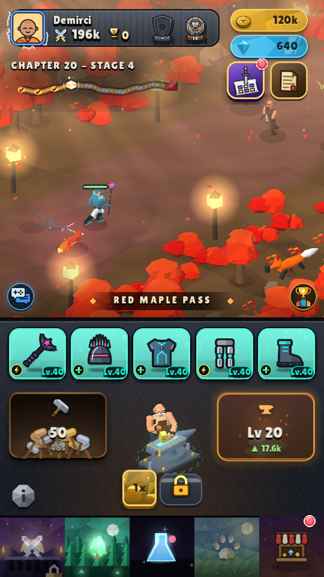
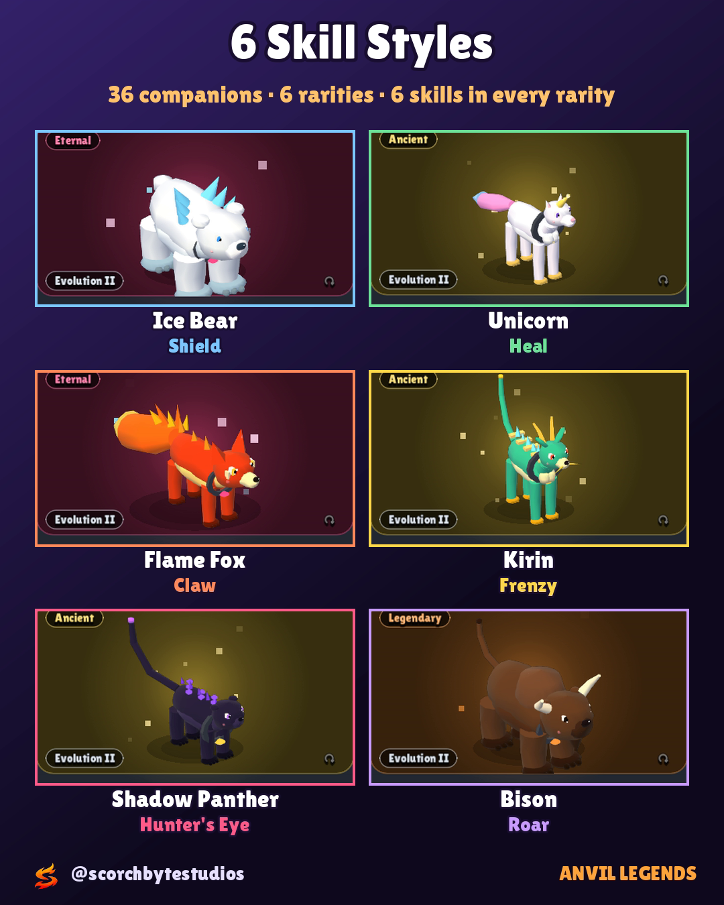

  

<h3 align="center">Hi, I'm Görkem — founder of ScorchByte Studios 🔥</h3>

  Indie mobile game studio from Istanbul, crafting colorful, satisfying games for players worldwide.

  
  
  

---

## ⚒️ Now building: Anvil Legends

**Forge legendary gear, hatch battle companions and rule the arena.**
A blacksmith RPG for Android: hammer out weapons and armor, upgrade your anvil, and send your hero through hand-crafted chapters with a loyal companion at their side.

- 🔨 **Forge & upgrade** — thousands of gear combinations, six rarities from Common to Ancient
- 🐾 **36 companions** — each with one of six battle skills: Shield, Heal, Claw, Frenzy, Hunter's Eye and Roar
- ⚔️ **Ranked League & Endless Battle** — climb weekly leagues and seasonal trophies against real players
- 🌍 **Play in your language** — English, Türkçe, Deutsch, Русский, العربية

  
  &nbsp;&nbsp;
  

<i>Currently in closed testing on Google Play — launching soon.</i>

---

## 🤝 Let's talk

Open to publishing, partnership and collaboration inquiries.
📧 **info@scorchbytestudios.com** · 🌐 **[scorchbytestudios.com](https://www.scorchbytestudios.com)**

© ScorchByte Studios · Istanbul, Türkiye

